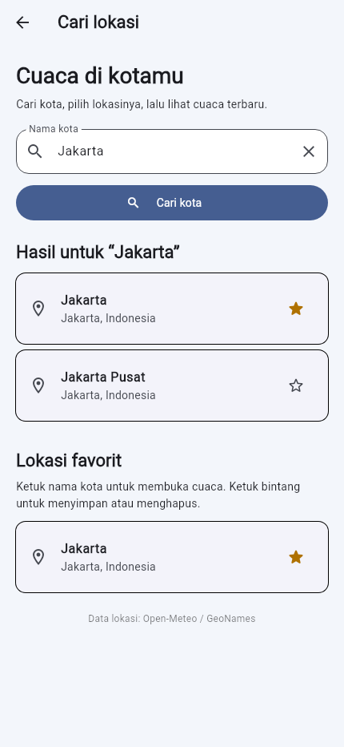

# Langit — Aplikasi Cuaca Flutter

## Fitur

- Home / Weather Screen: kota terpilih, kondisi cuaca, suhu, suhu terasa, kelembapan, angin, curah hujan, peluang hujan hari ini, serta prakiraan harian maksimum/minimum.
- Search / Location Screen: pencarian nama kota ke API, pemilihan hasil, simpan/hapus favorit, dan buka cuaca dari favorit.
- Favorit dan lokasi terakhir dipulihkan ketika aplikasi dibuka kembali.
- Indikator loading, hasil pencarian kosong, error koneksi, timeout dan tombol coba lagi.
- Material Design, ThemeData dan tipografi konsisten, layout yang dapat digulir serta jumlah kolom responsif.
- Refresh manual lewat ikon atau pull-to-refresh.

Aplikasi tidak meminta GPS; koordinat berasal dari hasil pencarian kota. Penyimpanan lokal hanya menyimpan lokasi, bukan cuaca offline. Cuaca membutuhkan internet. Pada web, gunakan origin (browser/profil/port) yang sama agar data lokal yang sama terbaca.

### 1. Geocoding API

`GET https://geocoding-api.open-meteo.com/v1/search`

Parameter: `name` dari input, `count=10`, `language=id`, `format=json`. Hasil `results` diubah menjadi daftar LocationModel. Field `id` dipakai sebagai identitas favorit, sehingga kota bernama sama tidak digabung secara keliru. Search dijalankan lewat tombol/Enter, dengan validasi minimal dua karakter.

### 2. Weather Forecast API

`GET https://api.open-meteo.com/v1/forecast`

Koordinat berasal dari lokasi yang dipilih. Parameter lainnya: `timezone=auto`, `forecast_days=7`, suhu Celsius, angin km/h, curah hujan mm.

| Informasi | Field API |
| --- | --- |
| Suhu | `current.temperature_2m` |
| Kelembapan | `current.relative_humidity_2m` |
| Suhu terasa | `current.apparent_temperature` |
| Curah hujan | `current.precipitation` |
| Kondisi cuaca | `current.weather_code` |
| Angin | `current.wind_speed_10m` |
| Siang/malam | `current.is_day` |
| Suhu maksimum harian | `daily.temperature_2m_max` |
| Suhu minimum harian | `daily.temperature_2m_min` |
| Peluang hujan maksimum harian | `daily.precipitation_probability_max` |
| Kondisi harian | `daily.weather_code` |

`current.precipitation` dalam mm, sedangkan peluang hujan dalam %. Peluang hujan hari ini menggunakan elemen pertama data harian (maksimum hari tersebut), bukan peluang hujan sesaat. Kode WMO dipetakan menjadi deskripsi dan ikon. Nilai null ditampilkan sebagai “—”. Waktu data ditampilkan dalam zona waktu lokasi dari API.

Tidak ada suhu atau hasil pencarian statis dalam kode aplikasi. Data fixture hanya ada pada folder test untuk pengujian otomatis yang deterministik.

## Local storage

Package `shared_preferences` menggunakan API `SharedPreferencesAsync`:

- `cuaca_favorites_v1`: string JSON daftar lokasi favorit.
- `cuaca_last_location_v1`: string JSON lokasi terakhir.

Saat initialize, data dibaca dan dipulihkan. Saat menambah/menghapus favorit, daftar pada layar berubah setelah penyimpanan berhasil. Kegagalan menampilkan pemberitahuan. Tidak ada database server.

## Penanganan state

| State | Tampilan |
| --- | --- |
| Belum memilih kota | Ajakan Pilih kota |
| Initializing/loading cuaca | CircularProgressIndicator |
| Loading pencarian | Indikator dan teks Mencari lokasi |
| Pencarian kosong | Kota tidak ditemukan |
| Error API | Pesan dan tombol coba lagi |
| Tidak ada favorit | Penjelasan cara menyimpan favorit |
| Gagal penyimpanan | Pemberitahuan error lokal |
| Berhasil | Data kota/cuaca/favorit yang sesuai |

## Screenshot

Gambar di bawah dirender dari widget aplikasi pada pengujian Flutter berukuran 430 × 932. Data cuacanya menggunakan respons Open-Meteo yang diambil saat penyusunan paket (waktu data: 26 November 2026 00:15, Asia/Jakarta). Ini bukan tangkapan dari HP pengguna; ambil ulang di perangkatmu sebelum pengumpulan. Cuaca akan berubah sesuai waktu request.

### Halaman cuaca

### Prakiraan harian

### Pencarian dan favorit

### Daftar favorit

