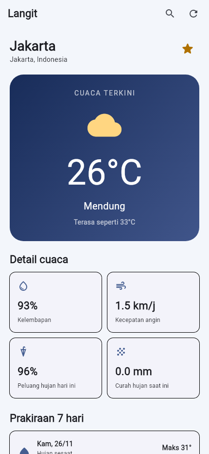
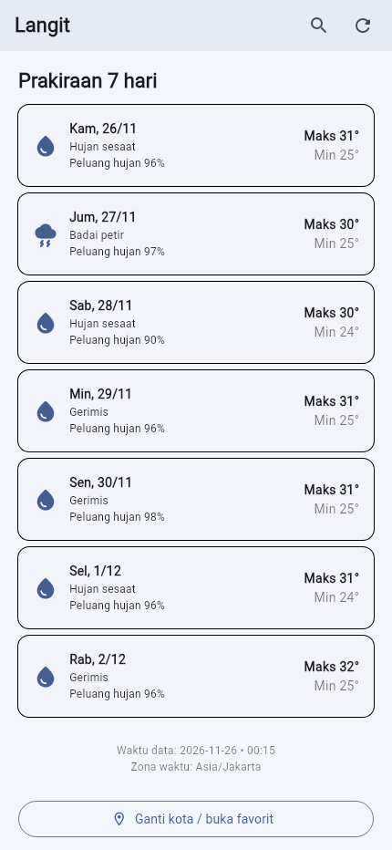
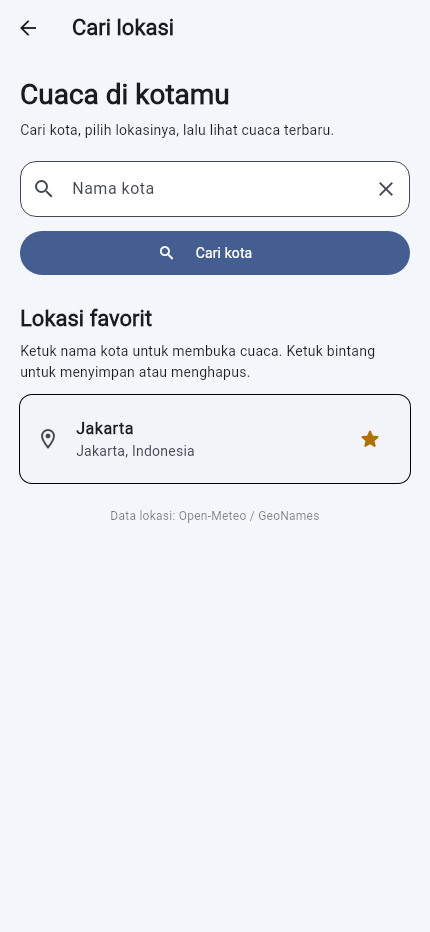

# Langit — Aplikasi Cuaca Flutter

Aplikasi responsi Flutter dengan pencarian kota, cuaca terkini, prakiraan tujuh hari, dan favorit lokal. Data cuaca dan hasil pencarian berasal dari REST API Open-Meteo melalui HTTP GET.

- Nama: **TODO: isi nama mahasiswa**
- NIM: **TODO: isi NIM mahasiswa**
- Mata kuliah/kelas: **TODO: isi kelas**
- Video penjelasan kode: **TODO: tambahkan tautan video yang dapat diakses dosen**

## Menjalankan proyek

Buka folder yang memiliki `pubspec.yaml` di VS Code. Paket ini sudah berisi struktur Android dan web, jadi tidak perlu membuat proyek baru.

```sh
flutter pub get
flutter analyze
flutter test
flutter run -d chrome --web-port=7357
```

Untuk Android, aktifkan USB debugging, periksa `flutter devices`, lalu `flutter run -d ID_HP`. Izin INTERNET sudah disertakan. Android SDK diperlukan untuk build Android. Panduan lengkap instalasi, troubleshooting, GitHub dan pengumpulan terdapat pada [MULAI_DI_SINI.md](MULAI_DI_SINI.md).

## Fitur

- Home / Weather Screen: kota terpilih, kondisi cuaca, suhu, suhu terasa, kelembapan, angin, curah hujan, peluang hujan hari ini, serta prakiraan harian maksimum/minimum.
- Search / Location Screen: pencarian nama kota ke API, pemilihan hasil, simpan/hapus favorit, dan buka cuaca dari favorit.
- Favorit dan lokasi terakhir dipulihkan ketika aplikasi dibuka kembali.
- Indikator loading, hasil pencarian kosong, error koneksi, timeout dan tombol coba lagi.
- Material Design, ThemeData dan tipografi konsisten, layout yang dapat digulir serta jumlah kolom responsif.
- Refresh manual lewat ikon atau pull-to-refresh.

Aplikasi tidak meminta GPS; koordinat berasal dari hasil pencarian kota. Penyimpanan lokal hanya menyimpan lokasi, bukan cuaca offline. Cuaca membutuhkan internet. Pada web, gunakan origin (browser/profil/port) yang sama agar data lokal yang sama terbaca.

## Arsitektur MVVM

| Lapisan | File | Tanggung jawab |
| --- | --- | --- |
| Model | `lib/models/location_model.dart` | Data lokasi, koordinat, fromJson dan toJson |
| Model | `lib/models/weather_model.dart` | Data cuaca current dan daftar DailyWeather |
| View | `lib/views/weather_screen.dart` | Antarmuka cuaca dan prakiraan |
| View | `lib/views/location_screen.dart` | Input pencarian, daftar lokasi dan favorit |
| ViewModel | `lib/viewmodels/weather_viewmodel.dart` | State, pencarian, pemilihan kota, favorit, loading dan error |
| Service API | `lib/services/weather_service.dart` | HTTP GET, timeout, status HTTP dan decoding JSON |
| Service storage | `lib/services/local_storage_service.dart` | SharedPreferencesAsync untuk JSON lokasi |
| Widget bersama | `lib/widgets/` | Panel state dan pemberitahuan penyimpanan |
| Helper tampilan | `lib/utils/weather_display.dart` | Label kode cuaca, ikon, tanggal, dan satuan |
| Entry point | `lib/main.dart` | Provider, inisialisasi dan ThemeData |

Alur aksi: View memanggil method ViewModel → ViewModel menggunakan service → service menghasilkan Model → ViewModel memperbarui state dan memanggil notifyListeners → context.watch pada View membangun ulang tampilan.

Satu WeatherViewModel dibagikan ke dua screen melalui ChangeNotifierProvider agar lokasi terpilih dan favorit konsisten. Nomor request mencegah respons pencarian/cuaca yang terlambat menimpa permintaan yang lebih baru. Data cuaca sebelumnya dikosongkan ketika memuat kota baru.

`WeatherScreen` menggunakan StatelessWidget karena state berada di ViewModel. `LocationScreen` menggunakan StatefulWidget untuk lifecycle TextEditingController, termasuk dispose.

## Implementasi API

### 1. Geocoding API

`GET https://geocoding-api.open-meteo.com/v1/search`

Parameter: `name` dari input, `count=10`, `language=id`, `format=json`. Hasil `results` diubah menjadi daftar LocationModel. Field `id` dipakai sebagai identitas favorit, sehingga kota bernama sama tidak digabung secara keliru. Search dijalankan lewat tombol/Enter, dengan validasi minimal dua karakter.

### 2. Weather Forecast API

`GET https://api.open-meteo.com/v1/forecast`

Koordinat berasal dari lokasi yang dipilih. Parameter lainnya: `timezone=auto`, `forecast_days=7`, suhu Celsius, angin km/h, curah hujan mm.

| Informasi | Field API |
| --- | --- |
| Suhu | `current.temperature_2m` |
| Kelembapan | `current.relative_humidity_2m` |
| Suhu terasa | `current.apparent_temperature` |
| Curah hujan | `current.precipitation` |
| Kondisi cuaca | `current.weather_code` |
| Angin | `current.wind_speed_10m` |
| Siang/malam | `current.is_day` |
| Suhu maksimum harian | `daily.temperature_2m_max` |
| Suhu minimum harian | `daily.temperature_2m_min` |
| Peluang hujan maksimum harian | `daily.precipitation_probability_max` |
| Kondisi harian | `daily.weather_code` |

`current.precipitation` dalam mm, sedangkan peluang hujan dalam %. Peluang hujan hari ini menggunakan elemen pertama data harian (maksimum hari tersebut), bukan peluang hujan sesaat. Kode WMO dipetakan menjadi deskripsi dan ikon. Nilai null ditampilkan sebagai “—”. Waktu data ditampilkan dalam zona waktu lokasi dari API.

Tidak ada suhu atau hasil pencarian statis dalam kode aplikasi. Data fixture hanya ada pada folder test untuk pengujian otomatis yang deterministik.

## Local storage

Package `shared_preferences` menggunakan API `SharedPreferencesAsync`:

- `cuaca_favorites_v1`: string JSON daftar lokasi favorit.
- `cuaca_last_location_v1`: string JSON lokasi terakhir.

Saat initialize, data dibaca dan dipulihkan. Saat menambah/menghapus favorit, daftar pada layar berubah setelah penyimpanan berhasil. Kegagalan menampilkan pemberitahuan. Tidak ada database server.

## Penanganan state

| State | Tampilan |
| --- | --- |
| Belum memilih kota | Ajakan Pilih kota |
| Initializing/loading cuaca | CircularProgressIndicator |
| Loading pencarian | Indikator dan teks Mencari lokasi |
| Pencarian kosong | Kota tidak ditemukan |
| Error API | Pesan dan tombol coba lagi |
| Tidak ada favorit | Penjelasan cara menyimpan favorit |
| Gagal penyimpanan | Pemberitahuan error lokal |
| Berhasil | Data kota/cuaca/favorit yang sesuai |

## Screenshot

Gambar di bawah dirender dari widget aplikasi pada pengujian Flutter berukuran 430 × 932. Data cuacanya menggunakan respons Open-Meteo yang diambil saat penyusunan paket (waktu data: 26 November 2026 00:15, Asia/Jakarta). Ini bukan tangkapan dari HP pengguna; ambil ulang di perangkatmu sebelum pengumpulan. Cuaca akan berubah sesuai waktu request.

### Halaman cuaca



### Prakiraan harian



### Pencarian dan favorit


### Daftar favorit



## Verifikasi

Lihat [docs/VERIFIKASI.md](docs/VERIFIKASI.md) untuk hasil pemeriksaan paket. Jalankan ulang `flutter analyze` dan `flutter test` setelah melakukan perubahan. Uji manual pada perangkat yang akan dipakai saat demo.

## Pemetaan ke ketentuan PDF

| Persyaratan | Implementasi |
| --- | --- |
| Flutter dan Dart | Seluruh kode aplikasi dalam lib |
| StatefulWidget dan StatelessWidget | LocationScreen dan WeatherScreen |
| Material Design, Theme, typography | CuacaApp / ThemeData di main.dart |
| Responsif | ListView, ConstrainedBox, LayoutBuilder, Wrap |
| Local storage dan pemulihan | LocalStorageService + initialize |
| Pengelolaan state | ChangeNotifier + Provider |
| Pencarian nama kota melalui API | searchCities + LocationScreen |
| REST API, GET dan JSON model | WeatherService dan fromJson |
| Loading, kosong dan error | StatePanel dan state ViewModel |
| MVVM | Pemisahan models / views / viewmodels |
| Dua screen minimum | WeatherScreen dan LocationScreen |
| Favorit | toggleFavorite dan daftar favorit |
| Dokumentasi | README serta panduan dan skrip video |
| Screenshot README | docs/screenshots |
| GitHub dan video | Diunggah mahasiswa setelah verifikasi dan pengisian identitas |

## Referensi

- [Open-Meteo Forecast API](https://open-meteo.com/en/docs)
- [Open-Meteo Geocoding API](https://open-meteo.com/en/docs/geocoding-api)
- [Flutter](https://docs.flutter.dev/)
- [http](https://pub.dev/packages/http)
- [provider](https://pub.dev/packages/provider)
- [shared_preferences](https://pub.dev/packages/shared_preferences)

Data cuaca oleh Open-Meteo (CC BY 4.0); data lokasi oleh Open-Meteo/GeoNames. Gunakan API publik sesuai ketentuan penggunaan penyedia. Pengumpulan tugas mengikuti instruksi dosen dan PDF Responsi Flutter.
